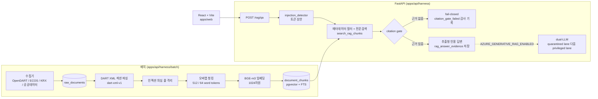

# korean-regulatory-rag-citation-gate

pgvector 기반 한국어 규정/공시 RAG 를 담은 PB/WM(자산관리) 직원용 AI 보조 웹서비스 PoC 입니다.

- OpenDART 공시 XML 섹션 파싱
- 인젝션 의심 줄 격리 뒤 오버랩 청킹
- BGE-m3(1024차원) 임베딩을 pgvector 에 적재
- 인용 근거가 없으면 답하지 않는 citation gate(fail-closed)
- 신뢰하지 않는 텍스트를 다루는 dual-LLM 격리(quarantined / privileged lane)

> 해커톤 이전에 진행한 개인 작업의 공개 사본입니다. 해커톤 제출물과 무관합니다.
> 공개 전에 비밀값, 내부 주소, 개인 정보, 실존 금융사명을 지우거나 가명으로 바꿨습니다. 정리 내역은 아래 "공개본 정리 내역"에 있습니다.

## 무엇인가

PB/WM 직원이 고액자산가 고객을 관리할 때 쓰는 내부형 웹서비스의 PoC 입니다. AI 는 의사결정 보조만 하고, 최종 판단은 직원이 합니다. 고객 데이터는 모두 합성 데이터입니다.

| 영역 | 내용 |
|---|---|
| RAG | 공시(OpenDART)와 교육용 매뉴얼 문서를 청크로 나눠 저장하고, 질의에 인용 근거와 함께 답함 |
| 업무 흐름 | 고객 360, 상담 4-gate(적합성/설명의무/부당권유/광고), 하우스뷰, NBA, 사후관리, 이메일 초안 |
| 통제 | 역할 6종 RBAC(PB, WM, 지점장, 관리자, 감사 열람, 준법감시), 감사 로그(append-only), 4-eyes 승인, AI 출력에 생성 시각과 모델명 표기 |
| 방어 | 인젝션 탐지, 출력 정제, PII 마스킹, 토큰 상한, faithfulness 점검 |

## 구성도



### RAG 경로 세부

| 단계 | 파일 | 동작 |
|---|---|---|
| 섹션 파싱 | `apps/api/harness/batch/documents.py` | `extract_dart_xml_sections`. XML 트리를 걸으며 섹션 경로(`SECTION-1:II. 사업의 내용/...`)를 붙임. XML 이 깨지면 원문 한 덩어리로 처리 |
| 인젝션 격리 | 같은 파일 | `sanitize_untrusted_document_text`. "ignore previous instructions" 같은 줄을 지우고 개수를 `quarantined_lines` 로 남김 |
| 청킹 | 같은 파일 | `chunk_text`. 기본 512 토큰, 64 토큰 겹침. 50자 미만 조각은 버림 |
| 임베딩 | `apps/api/harness/batch/embedding.py`, `external/bge.py` | BGE API 호출 결과를 `vector(1024)` 로 적재 |
| 스키마 | `db/migrations/V007__documents_chunks.sql`, `V013`, `V032` | 청크, 출처(접수번호, 기업코드, 섹션 경로, 파서 버전), 답변 근거 테이블 |
| 검색 | `apps/api/harness/repositories/documents.py` | `search_rag_chunks`. 임베딩이 끝난 청크만 대상. 출처 유형, 기업코드, 접수번호, 기간 필터와 `ts_rank_cd` 전문검색 |
| 질의 | `apps/api/harness/api/routers/ai.py` | `/rag/qa`. 인용이 0건이면 답하지 않고 사유 코드와 감사 로그를 남김 |
| dual-LLM | `apps/api/harness/services/ai_jobs.py` | `call_quarantined_llm` 는 도구 없이 요약만, `call_privileged_llm` 는 격리 출력만 데이터로 받아 답을 구성 |
| 설계 문서 | `docs/ai/AI-04_rag_spec.md`, `docs/architecture/ADR-005_dual_llm_quarantine.md`, `docs/batch/BATCH-05_embedding_spec.md` | |

## 디렉터리

| 경로 | 내용 |
|---|---|
| `apps/api/` | FastAPI 백엔드. ORM 없이 순수 SQL(`/* sql_id: ... */` 주석 필수) |
| `apps/web/` | React + Vite 프런트엔드, Vitest, Playwright e2e |
| `db/` | 버전형 SQL 마이그레이션(V001-V084), 자체 마이그레이터, 합성 시드 |
| `docs/` | 제품, 업무, 규제, DB, API, AI, 배치, 보안, 운영 문서와 ADR |
| `prompts/` | 에이전트별 프롬프트 템플릿과 인젝션 패턴 |
| `eval/`, `security/` | RAGAS/DeepEval 설정, OWASP LLM Top 10 프로브 |
| `scripts/` | 실행, 배치, 검증, 감사 스크립트 |
| `tests/` | pytest. RAG golden 10건(`tests/goldens/rag`), adversarial 테스트 포함 |
| `examples/` | DB 없이 도는 수집 파이프라인 데모와 가상 공시 XML |
| `PLANS.md`, `BACKLOG.md`, `MEMORIES.md` | 개발 진행 기록 |

## 실행 방법

### 1. DB 없이 수집 파이프라인 보기

가상 공시 XML 한 건을 파싱, 격리, 청킹하고 1024차원 고정 벡터 형태까지 출력합니다. 고정 벡터는 의미 임베딩이 아니라 pgvector 형태 확인용입니다.

```bash
pip install asyncpg   # apps.api.harness.core.db 가 import 시점에 필요
python examples/offline_rag_pipeline_demo.py --chunk-tokens 40 --overlap-tokens 8
```

출력 예시(일부)

```text
source: dart_sample_document.xml
sections: 7  quarantined_lines: 1
[1] DOCUMENT/BODY/SECTION-1:I. 회사의 개요/P  (quarantined=1)
  chunk 1: tokens=31 text=가상전자 주식회사는 가상의 반도체 부품 제조사로, ...
```

### 2. 전체 스택

필요한 것

| 항목 | 버전 |
|---|---|
| Python | 3.11.5 (`pyproject.toml` 과 시작 검사가 고정) |
| PostgreSQL | 17 + pgvector |
| Redis | 단일 인스턴스 또는 Sentinel |
| Node.js | npm 포함. 정리 시 v22 로 검사 |
| 외부 API | Azure OpenAI, BGE-m3 임베딩 엔드포인트. 시장 데이터는 OpenDART/ECOS/KRX 키가 있을 때만 수집 |

절차

1. 환경 파일 준비
   ```bash
   cp .env.example .env
   ```
2. `.env` 에서 아래 값을 채움
   - `PYTHON_PATH`, `HARNESS_CANONICAL_PYTHON_PATH`: 같은 인터프리터 경로
   - `DATABASE_URL`, `REDIS_URL`, `JWT_SECRET`
   - `AZURE_OPENAI_*`, `BGE_EMBEDDING_API_URL`, `BGE_EMBEDDING_API_KEY`
3. 의존성 설치
   ```bash
   pip install "asyncpg>=0.29" "fastapi>=0.110" "openai>=1.40" "pykrx>=1.2.8" "pypdf>=5.0" \
       "pyyaml>=6.0" "redis>=5" "reportlab>=4.0" "uvicorn>=0.29" "websockets>=12,<14" "wsproto>=1.0" \
       python-dotenv pytest
   (cd apps/web && npm install)
   ```
   - 선택 의존성: `apscheduler`(배치 스케줄러), `httpx`(비밀번호 유출 조회), `deepeval`(faithfulness 보조 지표). 쓰는 기능에서만 import 함
4. 마이그레이션과 합성 시드
   ```bash
   python db/migrator.py
   python db/seed.py --profile full-mvp
   ```
5. 배치(변환과 임베딩)
   ```bash
   ./scripts/run_batch_pipeline.sh --profile full-mvp --all-stages --report .omx/reports/batch/latest.json
   ```
   - 키가 없는 공급자는 `SKIPPED` 로 기록됨. 가짜 성공 행은 만들지 않음
6. 서버 시작, 상태 확인, 정지
   ```bash
   ./scripts/start.sh
   ./scripts/status.sh --deep --no-fail
   ./scripts/stop.sh
   ```
   - Web: `http://127.0.0.1:5173`
   - API health: `http://127.0.0.1:8000/health`

합성 로그인 계정(로컬 PoC 전용, 운영에 쓰지 말 것)

| 역할 | 이메일 | 비밀번호 |
|---|---|---|
| PB | `synthetic.pb1@example.invalid` | `HarnessSynthetic!2026` |
| WM | `synthetic.wm1@example.invalid` | `HarnessSynthetic!2026` |
| ADMIN | `synthetic.admin@example.invalid` | `HarnessSynthetic!2026` |

### 3. 테스트

```bash
python -m pytest -q                       # 일부는 PostgreSQL/Redis/API 서버가 필요(integration 마커)
(cd apps/web && npx tsc --noEmit && npx vitest run)
```

## 한계

- 질의 경로의 검색은 메타데이터 필터와 PostgreSQL 전문검색(`simple` 설정)입니다. pgvector 에 임베딩을 저장하지만 질의 시 벡터 유사도 검색은 쓰지 않습니다
- `BGE_RERANK_*` 설정과 리랭크 클라이언트는 있지만 질의 경로에 연결되지 않았습니다
- RAGAS, DeepEval 설정만 있고 공개할 정량 점수(faithfulness, recall 등)는 없습니다
- 생성형 dual-LLM 경로는 `AZURE_GENERATIVE_RAG_ENABLED` 가 켜졌을 때만 동작합니다. 기본은 추출형 citation gate 입니다
- `WMAH_USE_SYNTHETIC_EMBEDDINGS` 는 환경변수 계약과 고정 벡터 함수만 있고, 배치 임베딩 단계에는 연결되지 않았습니다
- 고객, 직원, 포트폴리오는 모두 합성 데이터입니다. 실제 금융 데이터나 실제 주문 전송은 없습니다
- 원본 시점 기준으로 실패하는 기존 테스트가 있습니다. 공개본 정리로 생긴 실패는 아닙니다
  - Vitest: 217건 중 6건(RBAC 라우트 표와 KYC 화면의 문자열 계약 불일치)
  - pytest: 문서와 코드 사이 계약 드리프트 일부(예: `ErrorCode` 개수 검사)
- `apps/web/package-lock.json` 이 `package.json` 과 맞지 않아 `npm ci` 가 실패합니다. `npm install` 을 쓰세요
- `docs/` 의 운영 문서(runbook)는 원본 PoC 서버 기준이고, 호스트명은 `*.internal.example` 가명, 사설 주소는 `<...>` 자리값입니다

## 공개본 정리 내역

| 구분 | 처리 |
|---|---|
| 제외 | `.env` 계열, 에이전트 세션 산출물(`.omc/`, `.omx/`, `.claude/`, `.serena/`, `.deepeval/`), 감사 번들(`audit-bundle-*.tgz`, `audit-out/`), 에이전트 설정 파일 |
| 제외 | 내부 엔드포인트와 키가 하드코딩된 테스트 1건, 제외한 세션 산출물을 읽는 테스트 3건 |
| 환경변수화 | 스크립트의 DB 접속 문자열은 `DATABASE_URL` 로 바꿈. 누락된 키 이름은 `.env.example` 에 추가 |
| 가명 | 내부 IP와 호스트는 `*.internal.example` 로 바꿈. runbook 의 사설 주소와 대역은 `<redis-private-ip>`, `<db-private-ip>`, `<internal-cidr>` 자리값으로 바꿈. Azure 리소스명은 `<...-azure-resource>` 로 바꿈 |
| 일반화 | 금융사 사례 비교 문서(`docs/regulations/REG-03_bank_practice.md`)는 회사와 브랜드를 지우고 은행 PB, 증권 PB 같은 유형으로 묶음. 자산 기준은 범위로만 적음 |
| 일반화 | 특정 증권사 Open API 연동 이름은 `BROKER`(`external/broker.py`, `BROKER_*` 환경변수, `source_code='BROKER'`)로 바꿈. 엔드포인트 경로와 거래 ID 는 `BROKER_*_PATH`, `BROKER_*_TR_ID` 환경변수로 옮김 |
| 가명 | 합성 지점명은 `SYN 강남센터`, `SYN 부산센터` 로 바꿈 |
| 경로 | 개인 서버 절대경로를 저장소 상대경로로 바꿈(`Path(__file__)` 기준). 인터프리터 기본값은 `/opt/conda/envs/wm_env` |
| 이력 | 원본 git 이력은 포함하지 않음 |

## 라이선스

Apache License 2.0. `LICENSE` 를 보세요.
